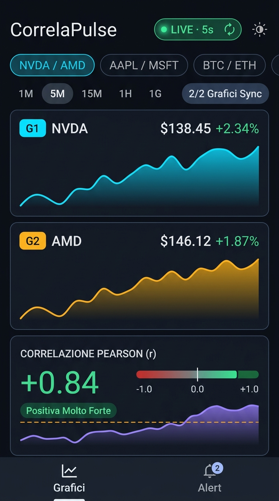

# CorrelaPulse

Applicazione Android nativa in **Kotlin** e **Jetpack Compose** per la visualizzazione in tempo reale delle quotazioni di borsa tramite un massimo di **2 grafici sincronizzati** nella stessa videata, il tracciamento dinamico del **coefficiente di correlazione di Pearson ($r$)** e la gestione di **alert personalizzati** al superamento di soglie configurabili.

## Videata Principale

<p align="center">
  
</p>

---

## 1. Descrizione Funzionale

### 1.1 Monitoraggio Quotazioni in Tempo Reale
- **Feed di mercato multi-asset**: Recupero dati live e serie storiche per azioni USA ed europee (es. `NVDA`, `AMD`, `AAPL`, `ENI.MI`, `ISP.MI`), ETF e indici (`SPY`, `QQQ`, `GLD`, `TLT`), criptovalute 24/7 (`BTC-USD`, `ETH-USD`) e coppie Forex (`EURUSD=X`).
- **Polling automatico concorrente**: Aggiornamento simultaneo delle serie selezionate ogni **5 secondi** tramite coroutine asincrone, con indicatore di stato (`LIVE · 5s` / `PAUSA`), aggiornamento manuale immediato e rilevamento dello stato del mercato (`MERCATO APERTO`, `PRE-MARKET`, `AFTER-HOURS`, `MERCATO CHIUSO`).
- **Ricerca globale ticker**: Bottom sheet dedicata con ricerca live tramite API Yahoo Finance Search e selezione rapida di coppie preconfigurate (`NVDA / AMD`, `AAPL / MSFT`, `BTC / ETH`, `SPY / QQQ`, `SPY / GLD`, `ENI / ISP`, `EUR/USD / Oro`).

### 1.2 Massimo 2 Grafici Sincronizzati
- **Limite controllato a 2 grafici (`1/2` o `2/2 Grafici Sync`)**: L'interfaccia mostra al massimo due grafici dinamici nella stessa videata (affiancati automaticamente su tablet e schermi `>= 820dp`, impilati su smartphone). È possibile nascondere o ripristinare il secondo grafico, invertire `G1 ↔ G2` oppure sostituire i titoli in qualunque momento.
- **Sincronizzazione temporale dei dati**: I punti delle due serie vengono allineati per bucket temporale in base al timeframe selezionato (`1M` · 1 giorno, `5M` · 5 giorni, `15M` · 1 mese, `1H` · 3 mesi, `1G` · 1 anno).
- **Modalità Scala Prezzo / Var %**: Commutazione istantanea tra valori assoluti nella valuta del titolo e variazione percentuale normalizzata dall'inizio della finestra temporale.
- **Cursore (Crosshair) Sincronizzato**: Trascinando o toccando qualsiasi punto su uno dei due grafici o sul grafico della correlazione, un mirino verticale si sposta simultaneamente su tutti i grafici aggiornando prezzi, variazioni percentuali, timestamp e valore locale di $r$.

### 1.3 Tracciamento del Coefficiente di Correlazione ($r$)
- **Calcolo di Pearson ($r \in [-1.0, +1.0]$)**:
  - **Modalità `Rendimenti`**: Calcola la correlazione sulle variazioni percentuali periodo per periodo ($\Delta P / P_{t-1}$).
  - **Modalità `Prezzi`**: Calcola la correlazione diretta sui livelli di prezzo sincronizzati.
- **Metriche visualizzate**: Coefficiente $r$ live (rolling), correlazione globale sull'intero periodo, coefficiente di determinazione $R^2$, numero di campioni sincronizzati ($N$) e classificazione qualitativa (da *Inversa Molto Forte* a *Positiva Molto Forte*).
- **Grafico Rolling & Indicatore Bipolare**:
  - Barra bipolare da `-1.0` a `+1.0` con ago della correlazione corrente e marcatori delle soglie attive.
  - Grafico dinamico della curva rolling $r(t)$ su finestra configurabile (`10p`, `15p`, `20p`, `30p`) con linee tratteggiate in corrispondenza delle soglie di alert abilitate.

### 1.4 Alert Personalizzati sulle Soglie di Correlazione
- **Regole configurabili**:
  - `Sopra (> r)`: scatta quando la correlazione supera la soglia impostata.
  - `Sotto (< r)`: scatta quando la correlazione scende sotto la soglia impostata.
  - `Forte (|r| > soglia)`: scatta in presenza di forte legame positivo o negativo.
  - `Decorrel. (|r| < soglia)`: scatta quando i due titoli perdono correlazione avvicinandosi a zero.
- **Ambito di applicazione**: Applicabile alla singola coppia selezionata (in modo simmetrico, `A/B` equivale a `B/A`) oppure a *Tutte le coppie*.
- **Notifiche e Cronologia**:
  - Cooldown anti-spam di **90 secondi** per singola regola.
  - Banner animato ad alta visibilità direttamente nella schermata principale.
  - Notifica locale di sistema Android ad alta priorità (`POST_NOTIFICATIONS` richiesto su Android 13+).
  - Persistenza locale delle regole e delle ultime 50 rilevazioni nella schermata **Alert**.

---

## 2. Architettura dell'Applicazione

L'applicazione adotta un'architettura **MVVM (Model-View-ViewModel)** combinata con i principi della **Clean Architecture**, garantendo separazione netta tra UI dichiarativa, logica matematica di dominio e sorgenti dati.

```
┌───────────────────────────────────────────────────────────────────┐
│                         UI Layer (Compose)                        │
│  MainActivity · TerminalScreen · AlertsScreen · Canvas Charts     │
│  Osserva StateFlow<MainUiState> via collectAsStateWithLifecycle   │
└───────────────────────────────┬───────────────────────────────────┘
                                │ Eventi utente / Azioni
┌───────────────────────────────▼───────────────────────────────────┐
│                     Presentation (ViewModel)                      │
│  MainViewModel: polling live 5s, ricerca debounced, scrub sync,   │
│  orchestrazione analisi e valutazione alert                       │
└──────────────┬───────────────────────────────────┬────────────────┘
               │                                   │
┌──────────────▼──────────────┐     ┌──────────────▼────────────────┐
│     Domain Layer (Pure)     │     │          Data Layer           │
│  CorrelationEngine:         │     │  MarketRepository (Retrofit)  │
│  - Allineamento bucket ts   │     │  AlertPreferencesRepository   │
│  - Pearson r & Rolling r    │     │  (DataStore + Moshi JSON)     │
│  - Valutazione soglie alert │     └──────────────┬────────────────┘
└─────────────────────────────┘                    │
                                    ┌──────────────▼────────────────┐
                                    │     Platform / Remote         │
                                    │  YahooFinanceApi (OkHttp)     │
                                    │  AlertNotificationHelper      │
                                    └───────────────────────────────┘
```

### Dettagli Architetturali Principali
- **Motore di Sincronizzazione e Correlazione (`CorrelationEngine`)**:
  - Pure Kotlin senza dipendenze Android (testabile in JVM).
  - Raggruppa i timestamp delle due serie in bucket discreti di ampiezza pari al timeframe (`60s`, `300s`, `900s`, `3600s`, `86400s`) ed effettua l'intersezione ordinata per garantire che ogni punto $i$ di Grafico 1 e Grafico 2 appartenga allo stesso istante temporale.
  - Calcola la serie rolling $r(t)$ con finestra adattiva e gestisce i casi limite (varianza nulla, serie con campioni ridotti, borse con fusi orari differenti).
- **Persistenza Locale (`AlertPreferencesRepository`)**:
  - Basata su **Jetpack DataStore Preferences** con serializzazione **Moshi** (`KotlinJsonAdapterFactory` / `codegen`) per salvare in modo reattivo (`Flow<UserPreferencesState>`) coppia attiva, timeframe, modalità di correlazione, finestra rolling, tema chiaro/scuro, regole di alert e storico degli scatti.
- **UI & Design System**:
  - Tema personalizzato (`CorrelaPulseTheme`) ispirato ai terminali quantitativi (`ObsidianBg #0B0F17`, `CyanSeriesA #00E5FF`, `AmberSeriesB #FFB300`, `VioletCorrelation #A78BFA`).
  - Font Google locali integrati in `res/font/`: **Space Grotesk** (titoli), **JetBrains Mono** (numeri tabellari `tnum` per prezzi e coefficienti) e **Inter** (testo UI).
  - Supporto **Edge-to-Edge** (`enableEdgeToEdge()`, `WindowInsets.safeDrawing`) e **layout adattivo** (`NavigationBar` su smartphone, `NavigationRail` + grafici affiancati su schermi `>= 840dp`).

### Struttura dei Package Principali

```text
app/src/main/java/com/example/
├── MainActivity.kt                         # Entry point, NavHost e fogli modali
├── data/
│   ├── local/
│   │   └── AlertPreferencesRepository.kt   # Persistenza DataStore + Moshi
│   ├── remote/
│   │   ├── NetworkModule.kt                # Configurazione OkHttp, Moshi, Retrofit
│   │   ├── YahooDtos.kt                    # DTO JSON Yahoo Finance
│   │   └── YahooFinanceApi.kt              # Interfaccia endpoint REST
│   └── repository/
│       └── MarketRepository.kt             # Fetch concorrente e ricerca ticker
├── domain/
│   ├── engine/
│   │   └── CorrelationEngine.kt            # Sync timestamp, Pearson r, alert engine
│   └── model/
│       ├── AlertModels.kt                  # Regole ed eventi di scatto alert
│       ├── MarketModels.kt                 # StockSeries, SynchronizedPoint/Analysis
│       └── TimeframeOption.kt              # Timeframe e CorrelationMode
├── notifications/
│   └── AlertNotificationHelper.kt          # Canale e notifiche di sistema Android
└── ui/
    ├── MainViewModel.kt                    # StateFlow, polling loop e azioni UI
    ├── components/
    │   ├── CorrelationTrackerCard.kt       # Gauge bipolare e grafico rolling r(t)
    │   ├── CreateAlertSheet.kt             # Creazione/modifica soglie alert
    │   ├── StockChartCard.kt               # Grafico Canvas sincronizzato con scrub
    │   └── TickerPickerSheet.kt            # Ricerca e selezione titoli
    ├── screens/
    │   ├── AlertsScreen.kt                 # Gestione regole e cronologia scatti
    │   └── TerminalScreen.kt               # Videata principale (max 2 grafici + r)
    ├── theme/
    │   ├── Color.kt
    │   ├── Theme.kt
    │   └── Type.kt
    └── util/
        └── FormatUtils.kt                  # Formattazione prezzi, %, r e date
```

---

## 3. Elenco Completo delle Dipendenze

### 3.1 Configurazione SDK & Toolchain
| Componente | Versione / Valore | Note |
| :--- | :--- | :--- |
| **Application ID** | `com.aistudio.correlapulse.mzvqkr` | Identificativo univoco pacchetto |
| **Namespace** | `com.example` | Package sorgenti e risorse `R` |
| **Compile SDK** | `36` (minor API level 1) | Android 16 |
| **Target SDK** | `36` | Android 16 |
| **Min SDK** | `24` | Android 7.0+ |
| **Java Compatibility** | `JavaVersion.VERSION_11` | Bytecode target |
| **Gradle** | `9.3.1` | Wrapper in `gradle/wrapper/` |
| **Android Gradle Plugin (AGP)** | `9.1.1` | `com.android.application` |
| **Kotlin** | `2.2.10` | Con Compose Compiler plugin |
| **KSP** | `2.3.5` | `com.google.devtools.ksp` |

### 3.2 Plugin Gradle (`app/build.gradle.kts`)
- `com.android.application` (`9.1.1`)
- `org.jetbrains.kotlin.plugin.compose` (`2.2.10`)
- `com.google.devtools.ksp` (`2.3.5`)
- `com.google.android.libraries.mapsplatform.secrets-gradle-plugin` (`2.0.1`)
- `com.google.gms.google-services` (`4.5.0`) — configurato con `MissingGoogleServicesStrategy.WARN`

### 3.3 Dipendenze di Produzione (`implementation` & `ksp`)

| Categoria | Libreria (Artifact) | Versione | Utilizzo nell'app |
| :--- | :--- | :--- | :--- |
| **AndroidX Core & Lifecycle** | `androidx.core:core-ktx` | `1.18.0` | Estensioni Kotlin e notifiche compatibili |
| | `androidx.lifecycle:lifecycle-runtime-ktx` | `2.8.7` | Lifecycle scopes |
| | `androidx.lifecycle:lifecycle-runtime-compose` | `2.8.7` | `collectAsStateWithLifecycle()` |
| | `androidx.lifecycle:lifecycle-viewmodel-compose` | `2.8.7` | Integrazione `MainViewModel` in Compose |
| | `androidx.activity:activity-compose` | `1.10.1` | `enableEdgeToEdge()` e `ActivityResultContracts` |
| **Jetpack Compose** | `androidx.compose:compose-bom` | `2024.09.00` | Bill of Materials Compose |
| | `androidx.compose.ui:ui` | *(BOM)* | Runtime e layout Compose |
| | `androidx.compose.ui:ui-graphics` | *(BOM)* | `Canvas`, `Path`, `Brush` per i grafici |
| | `androidx.compose.ui:ui-tooling-preview` | *(BOM)* | Annotazioni `@Preview` |
| | `androidx.compose.material3:material3` | *(BOM)* | Componenti Material Design 3 |
| | `androidx.compose.material:material-icons-core` | *(BOM)* | Icone Material base |
| | `androidx.compose.material:material-icons-extended` | *(BOM)* | Icone estese (`ShowChart`, `AddAlert`, ecc.) |
| **Navigazione & Storage** | `androidx.navigation:navigation-compose` | `2.8.9` | `NavHost` tra Grafici e Alert |
| | `androidx.datastore:datastore-preferences` | `1.1.7` | Persistenza preferenze, regole alert e storico |
| **Networking & JSON** | `com.squareup.retrofit2:retrofit` | `2.12.0` | Client HTTP REST Yahoo Finance |
| | `com.squareup.retrofit2:converter-moshi` | `2.12.0` | Converter JSON Retrofit/Moshi |
| | `com.squareup.okhttp3:okhttp` | `4.10.0` | Client HTTP e interceptor header |
| | `com.squareup.okhttp3:logging-interceptor` | `4.10.0` | Supporto logging HTTP |
| | `com.squareup.moshi:moshi-kotlin` | `1.15.2` | Serializzazione/deserializzazione Kotlin |
| | `com.squareup.moshi:moshi-kotlin-codegen` *(KSP)* | `1.15.2` | Generazione adapter `@JsonClass` a compile-time |
| **Concorrenza** | `org.jetbrains.kotlinx:kotlinx-coroutines-core` | `1.10.2` | Coroutine e `Flow` |
| | `org.jetbrains.kotlinx:kotlinx-coroutines-android` | `1.10.2` | Dispatcher Android (`Dispatchers.Main`) |

### 3.4 Dipendenze di Test e Debug
- **Unit & Robolectric (`testImplementation`)**:
  - `junit:junit:4.13.2`
  - `androidx.test:core:1.6.1`
  - `androidx.test.ext:junit:1.3.0`
  - `org.robolectric:robolectric:4.16.1`
  - `org.jetbrains.kotlinx:kotlinx-coroutines-test:1.10.2`
  - `androidx.compose.ui:ui-test-junit4` *(Compose BOM)*
- **Instrumented (`androidTestImplementation`)**:
  - `androidx.test.ext:junit:1.3.0`, `androidx.test:runner:1.6.2`, `androidx.test.espresso:espresso-core:3.7.0`, `androidx.compose.ui:ui-test-junit4`
- **Debug (`debugImplementation`)**:
  - `androidx.compose.ui:ui-tooling`, `androidx.compose.ui:ui-test-manifest`

### 3.5 Asset & Permessi Dichiarati
- **Font locali (`app/src/main/res/font/`)**: `space_grotesk.ttf`, `jetbrains_mono.ttf`, `inter.ttf`.
- **Permessi (`AndroidManifest.xml`)**:
  - `android.permission.INTERNET` (recupero quotazioni live e ricerca ticker)
  - `android.permission.ACCESS_NETWORK_STATE` (stato connettività)
  - `android.permission.VIBRATE` (feedback notifiche)
  - `android.permission.POST_NOTIFICATIONS` (permesso runtime su Android 13+ per le notifiche di superamento soglia)

---

## 4. Istruzioni di Build, Test e Deploy

### 4.1 Prerequisiti
- **JDK 17 o JDK 21** installato e configurato in `JAVA_HOME`.
- **Android SDK** con `platforms;android-36` e `build-tools` compatibili con AGP 9.1.1 (variabile d'ambiente `ANDROID_SDK_ROOT` o configurazione SDK in Android Studio).
- Connessione Internet attiva sul dispositivo o emulatore per ricevere i dati di mercato live. *(Non è richiesta alcuna API key per i feed di quotazione).*

### 4.2 Build Locale (Debug)

Da riga di comando nella root del progetto (usando il comando `gradle` di sistema o il Gradle Wrapper se disponibile):

```bash
# Compila l'APK di debug (firmato automaticamente con debug.keystore)
gradle :app:assembleDebug
```

L'APK generato sarà disponibile in:
`app/build/outputs/apk/debug/app-debug.apk`

Per installare su un dispositivo collegato via ADB:
```bash
adb install -r app/build/outputs/apk/debug/app-debug.apk
```

### 4.3 Esecuzione dei Test (Unit & Robolectric)

La suite di test verifica il motore matematico di sincronizzazione e correlazione (`CorrelationEngineTest`), la logica di cooldown degli alert e il contesto Android tramite Robolectric (`ExampleRobolectricTest`) senza necessità di emulatore:

```bash
# Esegue tutti i test unitari locali e Robolectric
gradle :app:testDebugUnitTest

# Esegue Android Lint
gradle :app:lintDebug
```

### 4.4 Build di Release e Firma Digitale

Il file `app/build.gradle.kts` configura automaticamente la firma `release` leggendo le credenziali dalle variabili d'ambiente:

| Variabile d'ambiente | Descrizione | Default |
| :--- | :--- | :--- |
| `KEYSTORE_PATH` | Percorso del keystore `.jks` di produzione | `${rootDir}/my-upload-key.jks` |
| `STORE_PASSWORD` | Password del keystore | — |
| `KEY_PASSWORD` | Password della chiave con alias `upload` | — |

#### Generazione APK di Release
```bash
export KEYSTORE_PATH="/percorso/al/tuo/my-upload-key.jks"
export STORE_PASSWORD="tua_store_password"
export KEY_PASSWORD="tua_key_password"

gradle :app:assembleRelease
```
Output: `app/build/outputs/apk/release/app-release.apk`

#### Generazione Android App Bundle (`.aab`) per Google Play Store
```bash
gradle :app:bundleRelease
```
Output: `app/build/outputs/bundle/release/app-release.aab`

*(Suggerimento per la pubblicazione: prima della release finale su Play Store, valutare l'attivazione di `isMinifyEnabled = true` e `isShrinkResources = true` nel `buildTypes.release` verificando eventuali regole in `app/proguard-rules.pro` per Moshi/Retrofit).*

### 4.5 Deploy su Dispositivo o Google Play
1. **Distribuzione diretta (APK)**:
   - Genera l'APK (debug o release) oppure esportalo dal menu impostazioni di Google AI Studio.
   - Trasferisci il `.apk` sullo smartphone Android, abilita l'installazione da origini sconosciute per il browser/file manager e installa.
2. **Distribuzione tramite Android Studio**:
   - Apri il progetto in Android Studio, attendi il Gradle Sync, collega il telefono con **Debug USB** attivo e seleziona **Run (`Shift+F10`)**.
3. **Pubblicazione su Google Play Console**:
   - Carica il file `app-release.aab` generato da `:app:bundleRelease` nella traccia desiderata (Internal Testing / Production) su Google Play Console.
   - Assicurati che `versionCode` e `versionName` in `app/build.gradle.kts` vengano incrementati ad ogni nuovo caricamento.
